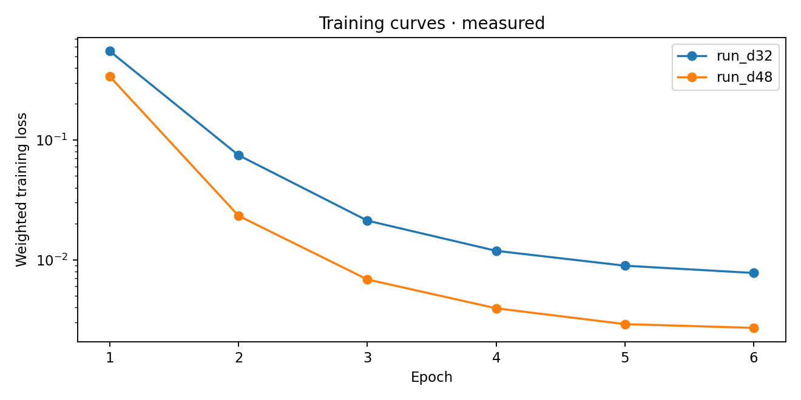
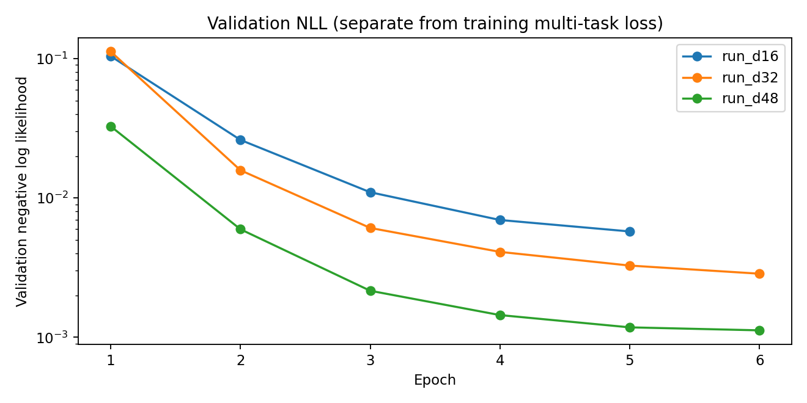
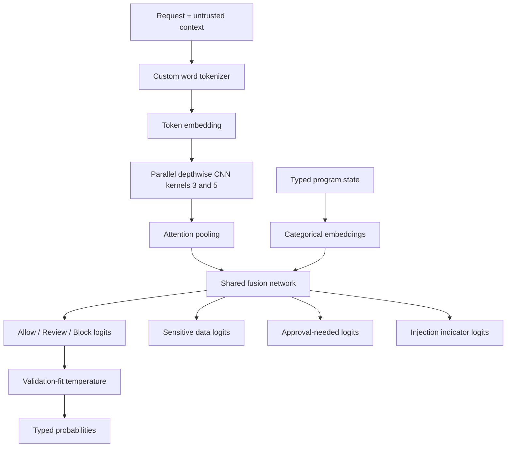
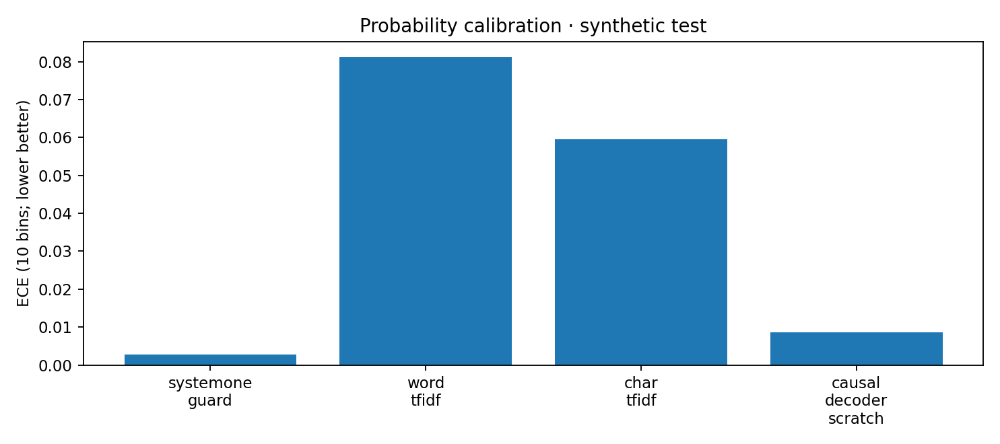

# jev-from-scratch

### A Jev-inspired, from-scratch System One decision model for agent tool-call risk assessment

**Single-pass typed probabilistic decisions • 21,306 parameters • calibrated outputs • matched evaluation against pretrained instruction LLMs**

[](#setup) [](#architecture) [](#limitations)

> **Research prototype, not an official Jev implementation.** This original model is inspired by the *typed-decision / parallel-inference* design philosophy described publicly for Jev. It does **not** replicate Jev’s proprietary weights, architecture, or RLCD algorithm. **Do not use it as a production security enforcement mechanism.**

## At a glance

| Property | Detail |
|---|---|
| Task | Agent tool-call risk triage: `ALLOW`, `REVIEW`, `BLOCK` |
| Input | Request text, untrusted context, and typed program state |
| Output | Parallel decision logits → calibrated probability distribution + auxiliary risk heads |
| Model | Custom PyTorch CNN + attention pooling + structured-state fusion |
| Size | **21,306 parameters** |
| Training | From scratch on a 10,000-example synthetic labeled training set |
| Real pretrained comparison | **SmolLM2-135M-Instruct** and **SmolLM2-360M-Instruct** via downloadable benchmarks |
| Strongest caution | **54.17%** accuracy on 24 manually authored probes; all 10 unseen injection phrasings missed |

**Jump to:** [Demo](#demo-live-typed-probabilistic-decision) · [Architecture](#architecture) · [Results](#measured-accuracy-synthetic-data) · [Pretrained comparison](#compare-against-real-pretrained-instruction-llms) · [Reproduce](#exact-reproducibility-commands) · [Limitations](#limitations)

## Compare against real pretrained instruction LLMs

The earlier **scratch-trained causal transformer** was **not** the pretrained System Two comparator requested. This corrected edition adds an actual Hugging Face pretrained LLM benchmark for **SmolLM2-135M-Instruct** and **SmolLM2-360M-Instruct**. These are existing instruction-tuned models; this project does not retrain them.

**Pretrained benchmark scores are not claimed here:** the local authoring runtime cannot download model weights from Hugging Face. Download/run the Colab notebook `notebooks/Compare_Pretrained_SystemOne_SystemTwo.ipynb` in an internet-enabled runtime, or run:

```bash
pip install -e '.[llm,dev]'
python scripts/compare_pretrained.py --split test --count 100 --threads 2 --device cpu --out experiments/pretrained_test_100.json
python scripts/plot_pretrained.py --input experiments/pretrained_test_100.json --out figures/pretrained_test_100
```

The script benchmarks **the same selected examples**, with strict typed output parsing, per-example predictions, accuracy/macro-F1, invalid output rate, **median and p95 per-request end-to-end CPU latency**, and actual plots. Both use two CPU threads, including input processing and output decoding; model downloads, initial loading and warmup are excluded. It also records SystemOne's typed decision probabilities. No pretrained-LLM scores are invented or copied from unrelated evaluations.

Read [complete protocol and limitations](docs/PRETRAINED_LLM_BENCHMARK.md). Model cards: [135M](https://huggingface.co/HuggingFaceTB/SmolLM2-135M-Instruct) and [360M](https://huggingface.co/HuggingFaceTB/SmolLM2-360M-Instruct).

## Demo: live typed probabilistic decision

```bash
pip install -e '.[dev,demo]'
python -m systemone_guard.inference
python spaces/app.py
```

```json
{
  "decision": "allow",
  "probabilities": {"allow": 0.999996, "review": 0.000004, "block": 0.0},
  "confidence": 0.999996,
  "review_recommended": false,
  "model_type": "single_pass_parallel_typed_decision"
}
```

The example above is the actual output of the packaged trained checkpoint in this environment (format shortened). The UI accepts an agent request, retrieved/tool context, action, sensitivity, destination, authorization, and trust source. It displays `allow/review/block` probabilities and separate sensitive-data, approval, and injection predictions. It **does not execute tools**.





## The problem

Agents increasingly read untrusted webpages, emails, PDFs, and tool responses before calling tools. Before a downstream tool executes, a policy system may need a fast, typed assessment: should the request be allowed, reviewed, or blocked? We simulate that decision over structured program state plus untrusted text. The task deliberately includes attacks, benign quotations of attack strings, sensitive-data movement, authorization, and destructive operations.

A powerful real deployment must use **deterministic permissions / allowlists / approval gates first**. The classifier is auxiliary and may be wrong or overconfident. The training data is synthetic, policy-generated, and highly limited.

## Architecture



The four heads are evaluated in one `torch.forward` call. There is no autoregressive text decoding. The selected model has **21,306 parameters**, randomly initialized and trained only on the bundled synthetic dataset, with no pretrained backbone, API, or hidden model.

The architecture is an *original compact classifier*, not Jev's proprietary network; its training uses standard weighted supervised cross-entropy and post-hoc temperature scaling, **not RLCD**.

## What was actually trained and compared?

| Model | Training | Data received | Status |
|---|---|---|---|
| SystemOne Guard (21K) | Random init, custom parallel encoder, 6 epochs, 10K examples | Request/context + structured state | Trained and evaluated |
| Word TF-IDF + logistic regression | Supervised 10K examples | Request/context + serialized same state | Trained and evaluated |
| Character TF-IDF + logistic regression | Supervised 4K examples (resource-limited) | Request/context + serialized same state | Trained and evaluated; **not equal data budget** |
| Tiny causal next-label transformer (18K) | Random init, 4 epochs, 10K examples | Request/context text, **not structured state embeddings** | Trained and evaluated; **not a comparable pretrained instruction model** |
| SmolLM2-135M-Instruct | Existing Apache-2.0 pretrained instruction model | Request/context + typed state in prompt | Colab **benchmark script included; NOT executed** (network inaccessible here) |
| SmolLM2-360M-Instruct | Existing Apache-2.0 pretrained instruction model | Request/context + typed state in prompt | Colab **benchmark script included; NOT executed** (network inaccessible here) |

The causal decoder is still a narrowly trained small model, not a general language model; **do not claim superiority over modern pretrained LLMs based on its score**. The actual SmolLM2 comparator needs to run in your connected Colab environment. See `scripts/compare_hf_llm.py`.

### Measured accuracy (synthetic data)

| Method | Validation 1,500 | Test 1,500 | Challenge 600 |
|---|---:|---:|---:|
| SystemOne Guard | 100% | 99.87% | 100% |
| Word TF-IDF | See report | 90.67% | 91.50% |
| Character TF-IDF | See report | 81.40% | 80.83% |
| Causal decoder scratch | See report | 88.13% | 78.83% |

The validation/test/challenge datasets share the same policy generator and attack-context dictionary; only *request templates* differ, and the challenge changes operation frequencies. The synthetic "challenge" should **not** be interpreted as an independent security red-team benchmark.

### Generalization warning: manual adversarial probes

Twenty-four manually worded probes (not generated by the training templates) yield **54.17% accuracy**. All **10 novel adversarial prompt-injection phrasings were missed**. See `experiments/manual_probes.json`. This is a serious failure and proves that the synthetic performance does not transfer reliably to new attacks. The model may be highly confident and wrong. Never put it on an agent's enforcement path without a stronger design, realistic labeled data, and separate validation.




### Timing

CPU, PyTorch, two threads, batch=128, 40 repeated forward passes after warmup (no tokenization/preprocessing):

| Model | Parameters | Median batch forward | Median amortized / item |
|---|---:|---:|---:|
| SystemOne Guard | 21,306 | 9.57 ms | 0.075 ms |
| Tiny causal decoder (scratch) | 19,011 | 14.15 ms | 0.111 ms |

These are *not* apples-to-apples pre-trained-LLM measurements and do not imply a 40–200x speedup over an LLM. End-to-end UI and CPU single-request latency will be different.

## Quick start

From the extracted project root:

```bash
python -m venv .venv
source .venv/bin/activate  # Windows: .venv\\Scripts\\activate
pip install -e '.[dev,demo]'
python -m pytest -q
```

Alternatively, with `uv`:

```bash
uv sync --extra dev --extra demo
uv run python -m pytest -q
```

Pretrained model artifacts are bundled under `artifacts/guard_best/model.pt`, so the demo works without training.

## Exact reproducibility commands

Training dataset regeneration, with fixed seed and completely generated deterministic labels:

```bash
python -m systemone_guard.data
```

Reproduce selected configuration (seed 7, embedding dimension 32, fusion hidden 64):

```bash
python -m systemone_guard.train --data data --out artifacts/reproduced \
  --epochs 6 --seed 7 --dim 32 --hidden 64 --lr 0.0015 --batch 128
```

**Checkpoint bytes may differ across PyTorch/OS versions.** The report is from the included checkpoint; reruns should be compared by metrics and seeds, not exact hashes. Repeated training is nondeterministic on some hardware. The runs under `artifacts/run_d16/`, `run_d32/`, `run_d48/` contain logs and checkpoint artifacts. One larger configuration (`run_d64`) was interrupted and is excluded from model selection.

Train a causal next-label transformer comparator (weaker, lower data budget):

```bash
python -m systemone_guard.causal --epochs 4 --limit-train 0 --dim 32 --layers 1
```

Run all available models on the same saved splits:

```bash
python -m systemone_guard.evaluate --split val
python -m systemone_guard.evaluate --split test
python -m systemone_guard.evaluate --split challenge
python scripts/evaluate_probes.py
python scripts/plot_results.py
python scripts/benchmark_latency.py
```

The test dataset was inspected during this project development and the manual probes were examined *after* model selection; do not call them a blinded final test. For real use, build a fresh independently labeled benchmark **before** additional model tuning.

### Compare with a real pretrained instruction LLM in Colab

```bash
pip install -e '.[llm]'
python scripts/compare_hf_llm.py \
  --model HuggingFaceTB/SmolLM2-135M-Instruct --split test --count 200
```

This script downloads an open-source model, prompts it with the **same** state and task policy, counts invalid outputs as incorrect, and saves both model predictions and end-to-end latency per example. It was **not run here**, because this runtime cannot access Hugging Face or download `transformers`. Hardware and inference method affect timing. The first 200 records are used as a fixed reproducible subset, and SystemOne is reevaluated on precisely those rows. Do not assert a win without running it.

## Colab notebook

Open `notebooks/Train_Evaluate_SystemOne_Guard.ipynb` in Google Colab, upload this whole ZIP in its setup cell, and run all. The notebook includes a retraining toggle and evaluates the packaged checkpoint by default. When running the pretrained LLM comparator, enable the optional GPU runtime to accelerate inference.

## File guide

- `systemone_guard/`: model, tokenizer, synthetic generator, training, inference, metrics, baselines, causal comparator
- `artifacts/`: real trained weights, experiment configs, histories, TF-IDF `.pkl` files (only load your trusted own files)
- `experiments/`: raw per-example predictions, metrics, run logs, measured timing, manual probes
- `figures/`: measured comparison, calibration, confusion, training loss, validation macro-F1
- `scripts/compare_hf_llm.py`: optional actual pretrained System Two comparison
- `notebooks/`: Colab workflow
- `spaces/`: Gradio app for HF Spaces
- `hf_model/README.md`: HF model card
- `docs/`: architecture, evaluation protocol and limitations

## Limitations

1. **Strong class imbalance (~70% of training labels are `block`), plus synthetic labels and an inspectable deterministic policy** make the task easy; a hand-coded oracle matching the policy generator can reach 100%. There is no claim the model beats that oracle.
2. **Novel attacks are missed.** The manual adversarial probe accuracy was 54.17% overall, 0/10 for unseen injection phrasing. It is not production-ready.
3. **Calibration is local.** Low ECE on synthetically generated data does not imply epistemically honest probabilities on novel threats.
4. **Not full Jev/RLCD.** The Jev network and optimization procedure are not public; this is original supervised multi-task training plus validation-set temperature scaling.
5. **Pretrained LLM not benchmarked in this environment.** The compatible Colab script is included, but its result is intentionally blank.
6. **Unbalanced baseline budgets.** Character TF-IDF trained with 4K examples; the word TF-IDF, causal decoder and SystemOne Guard each used 10K. Training objectives and model size still differ.
7. **No true semantic robustness** established by this artificial corpus. Real-world tool context contains new dialects, nested instructions, adversarial encoding and complex user authorization states.

## Reference and attribution

- TypeSafe AI, *Introducing System One Models & Jev* (2026): https://typesafe.ai/blog/introducing-system-one-models-and-jev
- Hugging Face, *SmolLM2-135M-Instruct*: https://huggingface.co/HuggingFaceTB/SmolLM2-135M-Instruct

MIT licensed code. The synthetically generated data is made for this demonstration. No private user information is included.

### Additional evidence

- [Experiment ledger](docs/REPRODUCIBILITY_REPORT.md)
- [Full evaluation limitations](docs/EVALUATION.md)
- [HF model card](hf_model/README.md)
- [Paired bootstrap comparison](experiments/bootstrap_summary.json)
- [Manually authored adversarial probes](experiments/manual_probes.json)
- [Standalone Hugging Face Space](dist/systemone-guard-space/)
