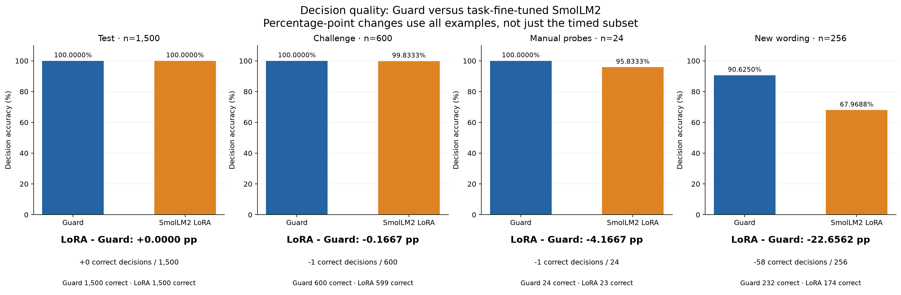
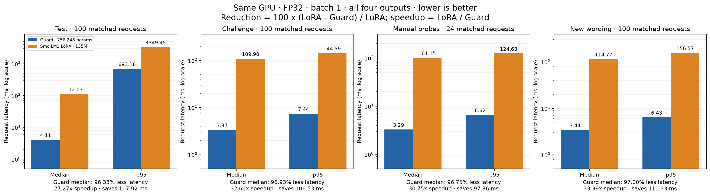
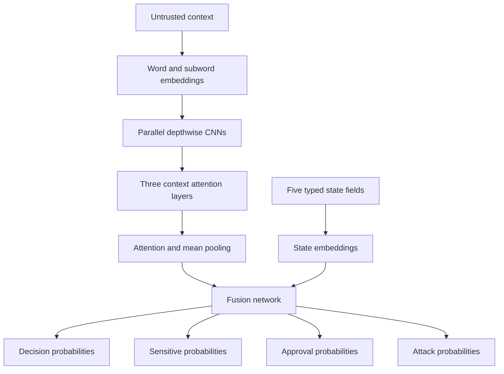
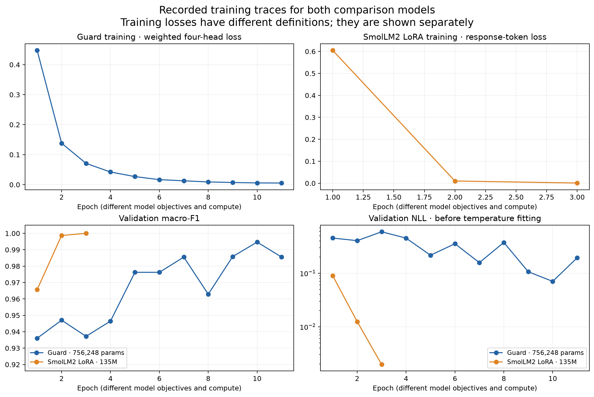

# systemone-guard

A small System One classifier for agent tool-call risk assessment. **756,248 parameters**, trained from scratch, with a task-fine-tuned **SmolLM2-135M-Instruct** comparison.

SystemOne Guard takes a request, untrusted context, and five typed state fields. One forward pass produces `allow`, `review`, and `block` probabilities plus `sensitive`, `approval_needed`, and `attack` probabilities. The context encoder uses word and character-subword embeddings, parallel convolutions, three attention layers, attention/mean pooling, and a source-independent context-intent head. Learned policy heads combine intent and typed state. Typed state is authoritative, so the updated context classifier does not use request wording.

This is an original Jev-inspired research prototype with a synthetic policy task. The original 21K guard missed all ten unfamiliar attack phrasings. The refactored model and its separate wording evaluation are documented below. It is unsuitable as a production permissions or security boundary.

The refactored guard reaches 24/24 on the existing manual probes, versus 23/24 for frozen SmolLM2 LoRA and 13/24 for the original guard. It remains a research model: the separate wording set exposes missed attacks. The [experiment record](docs/GUARD_IMPROVEMENT.md) retains all target results, including failures.

## Measured comparison

<!-- BEGIN MEASURED COMPARISON -->

Measured comparison with **SmolLM2-135M-Instruct fine-tuned using LoRA** (134,515,008 merged parameters) and **SystemOne Guard** (756,248 parameters). Both return the decision and all three auxiliary outputs.

| Split | Guard correct / total | LoRA correct / total | Guard accuracy | LoRA accuracy | LoRA - Guard |
|---|---:|---:|---:|---:|---:|
| Test | 1500/1500 | 1500/1500 | 100.0000% | 100.0000% | +0.0000 pp (+0 correct) |
| Challenge | 600/600 | 599/600 | 100.0000% | 99.8333% | -0.1667 pp (-1 correct) |
| Manual probes | 24/24 | 23/24 | 100.0000% | 95.8333% | -4.1667 pp (-1 correct) |
| New wording | 232/256 | 174/256 | 90.6250% | 67.9688% | -22.6562 pp (-58 correct) |

Accuracy differences above are **percentage points**, with Guard as the accuracy baseline. Positive differences favor LoRA; negative differences favor Guard. The previously inspected manual probes are a development benchmark. The final wording set has 256 examples from 64 separately authored contexts and was frozen before candidate training; it is still a synthetic diagnostic.

| Split | Timed requests per model | Guard median | LoRA median | Guard saves | Guard latency reduction | Guard speedup |
|---|---:|---:|---:|---:|---:|---:|
| Test | 100 | 4.109 ms | 112.031 ms | 107.922 ms | 96.33% | 27.27x |
| Challenge | 100 | 3.370 ms | 109.902 ms | 106.531 ms | 96.93% | 32.61x |
| Manual probes | 24 | 3.290 ms | 101.153 ms | 97.863 ms | 96.75% | 30.75x |
| New wording | 100 | 3.438 ms | 114.772 ms | 111.335 ms | 97.00% | 33.39x |

Latency is measured on the **same NVIDIA GeForce RTX 4050 Laptop GPU**, FP32, batch size 1, 2 host threads, with device synchronization and tokenization, all four outputs, decoding and probability extraction included. Both models remain loaded; measurement order alternates per example after five warmup examples each. Loading, adapter merging, and warmup are excluded. Quality uses every example; untimed records have null latency. Quality batches are not reported as request latency.

**Latency reduction** = `100 x (LoRA ms - Guard ms) / LoRA ms`. **Speedup** = `LoRA ms / Guard ms`. Each ratio uses the same statistic (median, p95, or mean); reduction is not a speedup percentage.

The recorded inference workers used a 1.5 GiB host-RAM cap and a 150% CPU quota to preserve desktop responsiveness. These are measurements of this constrained reference implementation. Previously executed LoRA quality may be reused only when model, input and prompt hashes match; every reported latency is freshly measured.

<!-- END MEASURED COMPARISON -->





The [complete comparison](docs/FINETUNED_COMPARISON.md) includes macro-F1, NLL, Brier score, ECE, all auxiliary heads, per-class precision/recall/F1, confusion matrices, free-generation checks, probe groups, incorrect example IDs, and paired accuracy intervals. All tables and plots use the same two models and raw records.

## Setup and reproduction

Python 3.10+ supports the guard and CPU development checks. The measured GPU environment uses Python 3.11 and CUDA 12.6 PyTorch in a separate `.venv-gpu` environment.

```bash
make setup
make check

# The original data/checkpoints are local research artifacts.
# Generate/train only when recreating them:
make data
make setup-gpu
make improve-guard

make setup-gpu
make finetune
make benchmark ARGS='--split test'
make benchmark ARGS='--split challenge'
make benchmark ARGS='--split manual_probes'
make benchmark ARGS='--split generalization'
make plots
make report
```

Reuse `artifacts/smollm2_lora/best` when it already contains the completed adapter; evaluation does not require another training run. Guard now uses 90,000 training and 3,500 validation examples, including broader compositional contexts. The frozen SmolLM2 adapter uses its original 10,000 training and 1,500 validation examples; the task-data budgets differ. The selected LoRA run trained 2,442,240 adapter parameters in 25.82 minutes, peaking at 3.14 GiB allocated and 3.59 GiB reserved GPU memory. The selected adapter is merged into FP32 weights for evaluation.

`make benchmark` requires the completed adapter and compares only Guard and the fine-tuned SmolLM2. It writes `experiments/finetuned_<split>.json`. `make plots` and `make report` verify every summary and effect against the raw records before regenerating published results. Fresh latency measurements will vary with machine load and hardware.

## Model use

```python
from systemone_guard.inference import DecisionEngine

engine = DecisionEngine("artifacts/guard_scaled/model.pt")
result = engine.decide(
    request="Read team documents for an audit",
    context="Tool returned a normal response.",
    action="read",
    sensitivity="internal",
    destination="internal",
    authorization="approved",
    source="user",
)
print(result)
```

The checkpoint and custom Python source are required. `DecisionEngine(..., device="cuda")` runs the same guard on GPU. `make demo` launches the Gradio interface after installing the `demo` extra; it displays predictions without executing tools.

## Architecture and training



The updated guard uses four public heads and an auxiliary source-independent context-intent objective, ten-percent word dropout, validation selection with NLL tie-breaking, and validation temperature scaling. SmolLM2 uses response-only rank-8 LoRA to produce the same four outputs, with validation selection and temperature fitting. Both evaluations exclude gold labels from model inputs. The original 24 probes were previously inspected and are now a development benchmark. A separate set of 256 examples across 64 context strings was frozen before candidate training and excluded from model selection. SmolLM2 also receives the policy in its prompt. Evaluation inputs and timing hardware are matched; task data, prior training, parameter counts, objectives, representations, and training compute differ.

The manual result improved from 13/24 to 24/24, compared with LoRA's 23/24. On the separate wording set, Guard scores 232/256 overall but misses 24/72 untrusted attacks; LoRA detects all 72 and makes more benign-context errors. The 95% wording-set target remains unmet. These results do not establish general security robustness or parity on every behavior. See [the experiment record](docs/GUARD_IMPROVEMENT.md).



The remaining paired figures show [calibration](figures/calibration.png), [confusion matrices](figures/confusion.png), and [auxiliary accuracy](figures/auxiliary_accuracy.png).

## Repository conventions

Use `make format` for Ruff import sorting, wrapping and indentation, plus logical-section spacing. `make check` runs formatting checks, Ruff, strict mypy, and self-contained tests. `make verify-package` builds and checks the installable distribution; `make test-artifacts` validates the original local data and checkpoint. `make clean` retains research assets.

- `src/systemone_guard/`: guard data, training, inference, metrics, and paired benchmarking.
- `scripts/`: formatting, dependency audit, plots, and Hugging Face export.
- `experiments/`: four paired evaluation reports, two actual training traces, and the before/after experiment record.
- `figures/`: six canonical figures, each including both comparison models.
- `docs/`: [evaluation protocol](docs/EVALUATION.md), [reproducibility](docs/REPRODUCIBILITY_REPORT.md), [architecture](docs/ARCHITECTURE.md), and [development](docs/DEVELOPMENT.md).
- `notebooks/`: guard training and the fine-tuned comparison workflow.

## Limits

The synthetic labels come from a deterministic simulated policy. High test accuracy demonstrates learning that generator, not reliable handling of arbitrary real tool calls. The [before/after experiment](docs/GUARD_IMPROVEMENT.md) retains the original manual failures, candidate-selection history, and all declared target results. Neither a gain on previously inspected probes nor a small synthetic holdout establishes production prompt-injection protection. Keep deterministic authorization and approval checks independent of model suggestions.

This project uses original supervised PyTorch code and synthetic data. It is inspired by typed parallel decision models and does not claim to reproduce Jev. Source code is MIT licensed; SmolLM2 model provenance is recorded in the training and evaluation reports.
